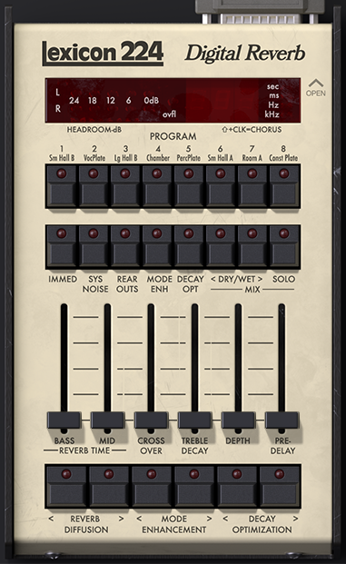

# Lexicon 224 — trích xuất giao diện, chưa khôi phục DSP

[Tải gói trích xuất một phần — khoảng 4,5 MB](https://github.com/tinhbovo280899-boop/tinh-studio-storep/raw/refs/heads/vst-fixed-downloads-20261027/LEX224_PARTIAL_UI_RECOVERY_20261031.zip). Đây là kết quả phân tích ZIP `.lunacomponent` do chủ dự án cung cấp. **Không phải mã nguồn DSP gốc, project C++/JUCE hoặc VST3 đã dựng lại.**

## Phần thu được

49 tệp giao diện gốc (45 PNG, HTML, JavaScript và hai JSON), giữ nguyên byte. 55 factory preset JSON giữ nguyên byte. JavaScript giao diện được định dạng thành 28.494 dòng, tách 83 module webpack có nội dung và các CSS/HTML nhúng. Phần lớn bundle có cả framework/client UI; số dòng này không phải số dòng thuật toán âm thanh.

Giao diện web gốc 381 × 621 đã render bằng Chromium. Có preview localhost trong ZIP, cần Python 3. Do không có dịch vụ host/DSP của UA, nút/đèn/meter chưa phản ánh một plugin đang chạy và preview không xử lý âm thanh.

## Phần chưa thu được

DLL Windows x64 1.4.16 có metadata PACE/iLok và section `.guard`; `.text` chính có entropy 7,999991 bit/byte. Đã đọc cấu trúc PE/export và thử disassembly tại entrypoint/ba export chính. Bootstrap có phần mã máy đọc được; vùng được bảo vệ không cho luồng DSP tin cậy để dựng lại thuật toán reverb. Không có C++/header/TypeScript/source map/PDB trong ZIP.

Không khôi phục được nguyên mã nguồn gốc 100%. Tên biến, comment, kiểu gốc và thông tin project có thể đã mất sau biên dịch/tối ưu hóa. Các module JavaScript được tách là mã UI đã biên dịch, không phải source TypeScript ban đầu. Preset chunk giải ra được nhưng chưa xác minh ánh xạ từng word; không coi preset là mã DSP.

Gói đầu vào là thành phần LUNA/UA chứa algo DLL, không phải một project VST3 có thể build lại từ các file này. Thu được tài nguyên giao diện không đồng nghĩa đã phục hồi được lõi âm thanh hoặc có thể ghép thuật toán hãng vào T-Lex224.

## Kiểm chứng

- 104 tệp UI/preset đối chiếu byte/SHA-256 với đầu vào.
- Cây cú pháp AST của bundle gốc và bản định dạng khớp nhau khi bỏ vị trí/cách viết literal; 85 tệp JavaScript qua kiểm tra cú pháp.
- Ba ca preview: bản gốc 1×, bản dễ đọc 1×, bản gốc 2×; không page error/tài nguyên HTTP lỗi. Hình bản gốc/bản dễ đọc 1× có sai khác pixel tối đa bằng 0 trong trạng thái chưa có host.
- Không chạy DLL hay xác nhận DSP/audio, native Windows/macOS/Cubase hoặc launcher Windows thực tế.

ZIP có tài nguyên UI, preset, code UI dễ đọc, báo cáo, ảnh preview, manifest và dấu vết phân tích. Không có DLL DSP, license blobs hoặc tệp kích hoạt. Giữ tác giả/tên tài nguyên UA/Lexicon; chưa ghép các tài nguyên này vào mã sản phẩm T Studio.

SHA-256: `acfafc3f2a2c10dd8fc68dffa82817f6721a82d1c6ec0373037056ecfc1d6a93`
