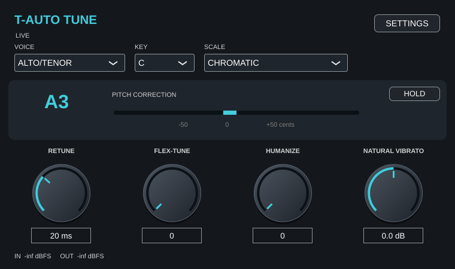

# T Studio Free FX Bundle — một gói gồm bốn VST3

[Tải ZIP nguồn Free FX Bundle — khoảng 31 MB](https://github.com/tinhbovo280899-boop/tinh-studio-storep/raw/refs/heads/vst-fixed-downloads-20261027/TStudio_Free_FX_Bundle_WIN_MAC_SOURCE.zip)

Gồm T-Verb, T-RVerb, PANTHEON II và LIQUID Delays II. Đã gỡ activation/trial/mã máy/nhập key và các tool cấp key của dự án. Giữ DSP, preset và VST3 component/controller IDs của bản sửa trước. Dùng chung một cây JUCE. Các giấy phép thư viện/font vẫn đi kèm.

- Windows: chạy `3_BUILD_VA_TAO_BO_CAI_WINDOWS.bat`; cần Visual Studio C++, CMake 3.22+ và Inno Setup 6.3+.
- macOS: chạy `3_BUILD_VA_TAO_BO_CAI_MAC.command`; cần Xcode Command Line Tools và CMake 3.22+.
- Có lựa chọn chỉ Build hoặc chỉ Tạo bộ cài.

Đầu ra `_EXPORT/VST3` và `_INSTALLERS`: một `.exe` Windows x64 hoặc một `.pkg` macOS Universal chứa đủ bốn plugin. ZIP hiện tại là **mã nguồn và quy trình build/bộ cài**, chưa chứa `.exe`/`.pkg` đã biên dịch native.

Đã build mới bốn VST3 trên Linux, đạt 13 test plugin + 2 test gói chung, thử sạch luồng SDK JUCE dùng chung, kiểm tra checksum/đủ plugin/sai nền tảng và xác nhận không còn symbol activation trong binary. Script Windows đã parse cú pháp, script macOS đã kiểm tra bash. Chưa chạy native Windows/macOS, ISCC/pkgbuild hay notarization. Chi tiết trong README, docs và VALIDATION của ZIP.

---

# Đợt sửa FX Send — T-Verb, vang ngắn và Delay

Giữ chất tiếng hiện tại theo lựa chọn của chủ dự án; sửa lỗi đã xác định và thêm preset FX Send riêng.

- [T-RVerb đã sửa](https://github.com/tinhbovo280899-boop/tinh-studio-storep/raw/refs/heads/vst-fixed-downloads-20261027/T-RVerb_V1_0_0_FIXED_WIN_MAC_SOURCE.zip)
- [T-Verb — preset mềm nhẹ FX Send](https://github.com/tinhbovo280899-boop/tinh-studio-storep/raw/refs/heads/vst-fixed-downloads-20261027/T-Verb_V1_0_0_FX_SEND_FIXED_WIN_MAC_SOURCE.zip)
- [PANTHEON II — preset vang ngắn FX Send](https://github.com/tinhbovo280899-boop/tinh-studio-storep/raw/refs/heads/vst-fixed-downloads-20261027/PANTHEON_II_V1_0_0_FX_SEND_FIXED_WIN_MAC_SOURCE.zip)
- [LIQUID Delay — đổi Time êm hơn + FX Send](https://github.com/tinhbovo280899-boop/tinh-studio-storep/raw/refs/heads/vst-fixed-downloads-20261027/LIQUID_DELAYS_II_V2_7_0_FX_SEND_FIXED_WIN_MAC_SOURCE.zip)

Các ZIP là **mã nguồn**, chưa phải plugin/bộ cài Windows hoặc macOS. Cả bốn đã build VST3 trên Linux và đạt các bộ test: T-RVerb 2/2, T-Verb 7/7 (320 kiểm tra engine), PANTHEON II 3/3, LIQUID Delay 4/4. Chưa build/test native Windows/macOS hoặc nghe đối chiếu với vocal thật.

Xem GHI_CHU_DOT_SUA_FX_SEND.md và TEST_RESULTS_BATCH trong từng ZIP để biết cách build, tên preset mới và các giới hạn. T-RVerb sửa NaN/Inf, signed predelay, mono→stereo, state/preset và tail; Delay thêm crossfade 20 ms khi đổi Time/BPM. Engine T-Verb/PANTHEON không đổi, preset mới thêm cuối danh sách. Giữ plugin ID và public license config; không có private key trong ZIP.

Với FX Send: chọn preset mới có hậu tố FX Send; return wet-only. Ở Delay, InLoop Off và cả hai delay On để tránh passthrough trực tiếp vào return.

---

# Bản mã nguồn VST đã sửa

Các ZIP đã sửa theo yêu cầu của chủ repo. Bấm link bên dưới để tải về máy:

- [Tải PANTHEON II](https://github.com/tinhbovo280899-boop/tinh-studio-storep/raw/refs/heads/vst-fixed-downloads-20261027/PANTHEON_II_V1_0_0_FIXED_WIN_MAC_SOURCE.zip)
- [Tải LIQUID DELAYS II](https://github.com/tinhbovo280899-boop/tinh-studio-storep/raw/refs/heads/vst-fixed-downloads-20261027/LIQUID_DELAYS_II_V2_7_0_FIXED_WIN_MAC_SOURCE.zip)
- [Tải 1176 LN 3D](https://github.com/tinhbovo280899-boop/tinh-studio-storep/raw/refs/heads/vst-fixed-downloads-20261027/1176_LN_3D_V1_0_0_FIXED_WIN_MAC_SOURCE.zip)
- [Tải T-Limiter](https://github.com/tinhbovo280899-boop/tinh-studio-storep/raw/refs/heads/vst-fixed-downloads-20261027/T-Limiter_V1_0_0_FIXED_WIN_MAC_SOURCE.zip)
- [Tải T-AutoTune LIVE 8.1.0](https://github.com/tinhbovo280899-boop/tinh-studio-storep/raw/refs/heads/vst-fixed-downloads-20261027/T-AutoTune_LIVE_V8_1_0_FIXED_WIN_MAC_SOURCE.zip)

Đây là mã nguồn, chưa phải bộ cài hoặc plugin Windows/macOS đã biên dịch. Cả năm dự án đã build VST3 trên Linux; chưa kiểm tra build native Windows/macOS. PANTHEON II và LIQUID DELAYS II vượt qua 3/3 bộ kiểm thử mỗi dự án; 1176 vượt qua 2/2 bộ kiểm thử. T-Limiter vượt qua 97 trường hợp kiểm thử engine, phép đo peak độc lập và kiểm thử wrapper. Xem README.md, GHI_CHU_BAN_SUA.md và TEST_RESULTS bên trong mỗi ZIP để biết cách build, những sửa đổi và giới hạn còn lại.

PANTHEON II vẫn sử dụng một mạng Chamber. HDFilter của LIQUID DELAYS II chưa có xử lý riêng. Chưa xác nhận tương đương thuật toán của hãng.

Các ZIP giữ nguyên public key và product ID; không chứa PRIVATE_KEY.txt. SHA256SUMS.txt dùng để kiểm tra file tải về. Nhánh này chỉ chứa bản tải xuống; nhánh main được giữ nguyên.

## Auto-Tune LIVE

Giao diện bốn nút chính và menu Settings hoạt động. Bản live loại nhánh LPC Formant/Throat cũ gây xung, cố định Classic Off, bỏ GRAPH và nhóm tạo rung giả/Transpose. Giữ Retune, Flex-Tune, Humanize, Natural Vibrato và dữ liệu tham số cũ để đọc state. Tính năng Formant không có trong bản live này; preset dùng các chức năng bị bỏ sẽ đổi âm thanh tương ứng. Đã build VST3 trên Linux, vượt qua 2/2 bộ kiểm thử; bộ DSP không cần GUI cũng vượt 1/1. Chưa kiểm tra native Windows/macOS hoặc tối ưu thêm độ trễ. Chi tiết trong GHI_CHU_BAN_LIVE.md bên trong ZIP.

## Gửi tệp lớn để phân tích

[Tải công cụ chia file 20 MB cho Windows](https://github.com/tinhbovo280899-boop/tinh-studio-storep/raw/refs/heads/vst-fixed-downloads-20261027/CONG_CU_CHIA_FILE_20MB.zip). Giải nén, kéo WAV/VST3/ZIP lên CHIA_FILE_GUI_EM.bat, rồi gửi toàn bộ ZIP và manifest.json trong thư mục GUI_EM_... Công cụ chia theo byte để người nhận ghép lại đúng file ban đầu; không tự tải dữ liệu lên mạng. Chi tiết kiểm thử và giới hạn nền tảng trong ZIP.

## T Studio 6 VST Bundle 1.0.1

[Tải gói sáu VST đã sửa](https://github.com/tinhbovo280899-boop/tinh-studio-storep/raw/refs/heads/vst-fixed-downloads-20261027/TStudio_6_VST_Bundle_V1_0_1_FIXED_WIN_MAC_SOURCE.zip).

Gồm Kaleidoscopes, T-API550, T-ConsoleEQ, T-HDelay, T-NS1 và T-Vitamin, vẫn là sáu VST3 riêng trong một quy trình tạo bộ cài. Sửa DC của CLA-2A, buffer MetaFlanger, khởi tạo/reset/tail HDelay, cấp phát audio callback Vitamin và lưu preset/profile NS1. Giữ mức khử Gentle và hành vi Solo Vitamin; chi tiết tiêu chí kiểm thử nằm trong ZIP.

Đã build cả sáu VST3 trên Linux, qua 12/12 nhóm CTest, 135 kiểm tra engine với sanitizer và 36 ca nạp/xử lý native mono/stereo. Mã nhận dạng plugin và khai báo tham số được giữ nguyên. Đây là mã nguồn miễn kích hoạt kèm script tạo bộ cài, chưa có EXE/PKG Windows/macOS đã biên dịch hoặc kiểm tra native. Chạy 1_BUILD_VA_TAO_BO_CAI_WINDOWS.bat hoặc 1_BUILD_VA_TAO_BO_CAI_MAC.command trên máy đích. Xem README, GHI_CHU_BAN_SUA_1_0_1.md và VALIDATION.txt trong gói.

## T Studio 5 VST Bundle 1.0.1

[Tải gói năm VST đã sửa](https://github.com/tinhbovo280899-boop/tinh-studio-storep/raw/refs/heads/vst-fixed-downloads-20261027/TStudio_5_VST_Bundle_V1_0_1_FIXED_WIN_MAC_SOURCE.zip).

Gồm T-BE, T-Comp, T-DeNoise, T-EQ và T-Pitch. Sửa state/profile, đổi sample rate, Learn im lặng và reset DeNoise; reset Pitch; bypass/reset của Comp/EQ; đọc key/scale đồng bộ cho BE. Giữ mã nhận dạng và khai báo tham số của cả năm.

Đã build 5/5 VST3 trên Linux, qua 10/10 nhóm kiểm thử (giữ nguyên tiêu chí test gốc), 30 ca VST3 native mono/stereo, và kiểm tra DeNoise với ASAN/UBSAN. Đây là ZIP mã nguồn kèm script build/test/tạo bộ cài; Windows/macOS native, EXE/PKG và DAW thật chưa được kiểm tra. Chạy 1_BUILD_VA_TAO_BO_CAI_WINDOWS.bat hoặc bản .command cho Mac. Profile DeNoise cũ không lưu sample rate nên cần Learn lại nếu đổi sample rate. Xem README, GHI_CHU_BAN_SUA_1_0_1.md, VALIDATION.txt và báo cáo trong ZIP.

## Vocal Dynamics Bundle 1.0.1 — T-DeEsser và T-RVox

[Tải gói hai VST đã sửa, khoảng 12 MB](https://github.com/tinhbovo280899-boop/tinh-studio-storep/raw/refs/heads/vst-fixed-downloads-20261027/TStudio_Vocal_Dynamics_DeEsser_RVox_V1_0_1_FIXED_WIN_MAC_SOURCE.zip).

Sửa Split/stereo/Monitor/headroom của DeEsser; đường cong nén đơn điệu, nội suy true-peak và lookahead limiter của RVox; reset, guard mẫu lỗi, preset và bypass của cả hai. Đã bỏ logo vẽ bằng mã trong giao diện, giữ tên/ID/tham số và preset cũ. Một bộ build và một bộ cài cho hai VST3 riêng.

DeEsser thêm FIR 64 mẫu tại 48 kHz; RVox cũng 64 mẫu. Tổng riêng hai plugin khoảng 2.67 ms ở 48 kHz. 5/5 nhóm CTest, 12 ca VST3 native Linux, core ASAN/UBSAN, 135 ca limiter và 24 ca plugin đo lại peak độc lập 16× đều qua. Test gốc RVox không sửa; DeEsser chỉ cập nhật kỳ vọng latency, giữ tiêu chí âm thanh.

ZIP là mã nguồn kèm JUCE/build/test/script tạo EXE hoặc PKG; chưa có bộ cài/plugin Windows/macOS đã biên dịch. Native Windows/macOS và vocal/DAW thật chưa được thử. Chạy 1_BUILD_VA_TAO_BO_CAI_WINDOWS.bat hoặc 1_BUILD_VA_TAO_BO_CAI_MAC.command trên máy tương ứng. Chi tiết và checksum trong README/Validation của ZIP.

## Vocal FX 4 VST Bundle 1.1.0

[Tải gói bốn VST đã sửa — khoảng 12 MB](https://github.com/tinhbovo280899-boop/tinh-studio-storep/raw/refs/heads/vst-fixed-downloads-20261027/TStudio_Vocal_FX_4_VST_Bundle_V1_1_0_FIXED_WIN_MAC_SOURCE.zip).

Gồm T-DeEsser 1.0.1, T-RVox 1.0.1, Sonitus fx Reverb 3.0.1 và D82 Sonic Maximizer 2.4.1. Hai plugin đầu giữ nguyên bản sửa trước. Reverb sửa Low Cut/Decay, delay modulation, mono routing, reset/tail, preset/A-B; Sonic Maximizer sửa sample-rate thấp, sample/parameter guard, chuyển Process/nút xoay, bypass/meter/reset/state. Đã bỏ ảnh/logo/filmstrip nhúng và dùng UI vẽ bằng mã cho hai plugin mới.

Build mới cả bốn VST3 Linux, qua 8/8 nhóm CTest, 36 native VST3 cases và core mới với ASAN/UBSAN/float-cast-overflow. Giữ parameter/preset arrays và tuple CID của hai plugin mới; code hai plugin cũ khớp byte với ZIP đã phát hành. Script Windows/macOS tạo một bộ cài cho bốn VST3 riêng.

Đây là ZIP mã nguồn kèm JUCE và script build/test/tạo bộ cài; chưa có VST3/EXE/PKG Windows/macOS đã biên dịch native. Chưa chạy native Windows/macOS hoặc vocal/DAW thật. Chạy 1_BUILD_VA_TAO_BO_CAI_WINDOWS.bat hoặc 1_BUILD_VA_TAO_BO_CAI_MAC.command. Với Reverb trên FX Send, bật Mute Dry. Chi tiết thay đổi âm thanh, GUI, giới hạn và checksum trong ZIP.

## Rà vòng đời 23 VST / Cubase Windows — 30/10/2026

[Tải báo cáo, bản vá menu T-EQ và tiện ích lấy thông tin Cubase](https://github.com/tinhbovo280899-boop/tinh-studio-storep/raw/refs/heads/vst-fixed-downloads-20261027/TStudio_23VST_LIFECYCLE_AUDIT_T_EQ_UI_PATCH.zip).

Đã rà bốn ZIP Compressor (2), FX (4), Plugins (15), VocalPack (2). Không trùng mã/tên plugin trong các ZIP; cùng JUCE 8.0.12. Bộ thử Linux hoàn tất 184 vòng đời processor / 138 vòng đời editor, chưa tái hiện treo. Gia cố callback menu T-EQ bằng SafePointer; 216 kiểm tra vòng đời với ASAN/UBSan qua. Bản vá mã nguồn chỉ chạm UI T-EQ và version T-EQ 2.0.5, không đổi DSP/parameter IDs/chính sách bản quyền.

**Chưa xác nhận nguyên nhân Cubase Windows treo, chưa sửa toàn bộ 23 VST, chưa có binary native mới.** ZIP có script PowerShell đọc phiên bản Cubase, metadata/hash VST3, event logs và danh sách dump; cần chạy trên máy Cubase rồi gửi kết quả trong cuộc trò chuyện để đối chiếu. Script không tự upload. T-AutoTune handoff/learn và thay đổi latency T-Comp/DeNoise/Pitch là các điểm cần xem tiếp; thông báo ở mức AudioProcessor không chứng minh gọi host đồng bộ vì JUCE VST3 đã có cơ chế chuyển luồng. Chi tiết và giới hạn trong DOC_TRUOC.md / Validation.

## Bản vá check bản quyền / AutoTune handoff — 30/10/2026

[Tải bản vá mã nguồn cho bốn gói](https://github.com/tinhbovo280899-boop/tinh-studio-storep/raw/refs/heads/vst-fixed-downloads-20261027/TStudio_LICENSE_AUTOTUNE_IO_FIX_PATCH_20261030.zip).

Sửa mirror trial không ghi được gây ghi lại mỗi giây; chờ 60 giây giữa các lần thử sửa, vẫn lưu thay đổi trạng thái quan trọng ngay. Worker dùng đồng hồ đơn điệu cho lịch kiểm tra, UTC thật cho ngày key/trial. AutoTune chỉ dò tài khoản hiện tại/đường dẫn đã cấu hình, ProgramData là fallback; không quét hồ sơ người dùng khác. Giới hạn handoff 256 KiB cả lúc stat lẫn read. Fixture 64 MB làm vòng UI gốc timeout 15 giây; bản vá bỏ qua file và vòng 600 ms hoàn tất bình thường. Đây là fixture tổng hợp, chưa phải file từ máy Cubase của người dùng.

68 kiểm tra chính sách bản quyền gốc, 130 hồi quy với partial ASAN/UBSan, 66 kiểm tra handoff và 40 vòng đời processor trên năm đại diện đều qua Linux. DSP/parameter layout/processBlock AutoTune khớp byte; không đổi key/config, trial policy, IDs hoặc phiên bản sản phẩm. 15 file source overlay có SHA256, backup và script Apply-Fix.ps1. Tương thích bản vá menu T-EQ trước vì không chạm UI/CMake.

Chưa có binary native mới, chưa xác nhận sửa đúng lần Cubase 15 Windows treo. Handoff I/O nhỏ vẫn ở constructor/prepare/timer; chưa chuyển toàn bộ sang worker. Timeout cưỡng bức stopThread và Learn/audio notification vẫn cần đối chiếu dump nếu tiếp tục treo. Các public_key.txt nguồn đều trống; bản vá giữ nguyên, cần dùng đúng public key của chủ dự án khi build. Đọc DOC_TRUOC.md trước khi áp dụng.

## Kiểm tra 31 VST — 31/10/2026

[Tải báo cáo và bản vá nguồn 5 file](https://github.com/tinhbovo280899-boop/tinh-studio-storep/raw/refs/heads/vst-fixed-downloads-20261027/TStudio_31VST_AUDIT_SOURCE_FIXES_20261031.zip).

Đủ 31 plugin từ bốn ZIP mới: kiểm tra vòng đời, DSP, định danh, license và VocalPack 1.7.3 ghép trên nền 1.7.2. Đã tái hiện và vá callback T-EQ dùng vùng nhớ đã giải phóng, chống NaN đầu vào cho T-Verb/T-Mod/T-Opto/T-TapeFlanger và sửa bù trễ host bypass T-Limiter. T-Compander nhận guard từ file dùng chung. Bản vá giữ ID/tham số/chính sách license và phần tạo màu tiếng.

Nguồn processor/editor của cả 31 plugin đã biên dịch trong harness Linux/JUCE 8.0.12; baseline 186 vòng đời processor / 124 editor, thử lại thêm 42 / 28 sau vá. License 68 kiểm tra, CapKey 19 kiểm tra logic nguồn, AutoTune 89 ca DSP, sáu regression chuyên biệt đều đạt. Harness Signal ghi lỗi vào JSON, không chỉ dựa exit code. Đã tái hiện lỗi callback gốc bằng ASan và xác nhận bản vá vượt cùng phép thử.

**Đây là báo cáo và bản vá tăng thêm, không phải bộ cài hay toàn bộ nguồn 31 VST. Chưa chạy DLL Windows trong Cubase 15.** Worker license vẫn có rủi ro đợi 30 giây khi I/O kẹt, chưa tái hiện ở các ca bình thường. T-Pitch mặc định báo trễ 120 ms, T-DeNoise Live 10,67 ms ở 48 kHz, nên cần xét cả chuỗi monitoring. Chi tiết, hash và log trước/sau trong ZIP và TSTUDIO_31VST_AUDIT_20261031.md.

## Kiểm tra tác động âm thanh 31 VST / T-PANTHEON — bổ sung 31/10/2026

[Tải báo cáo chức năng, bảng tham số, đồ thị và impulse response](https://github.com/tinhbovo280899-boop/tinh-studio-storep/raw/refs/heads/vst-fixed-downloads-20261027/TStudio_31VST_FUNCTION_AUDIT_PANTHEON_20261031.zip).

Lượt trước tập trung độ ổn định; lượt này đo thêm 561 tham số và 137 ngữ cảnh phụ thuộc. Xác nhận T-PANTHEON bỏ qua lựa chọn sáu loại vang: cùng cấu hình cho đầu ra giống từng mẫu ở 44.1/48/96 kHz. Ở mặc định RT60 2.03 s, đo T30 ngoại suy tại 1 kHz khoảng 1.027 s; Bass Boost 1.2x..2.5x không đổi vì chạm clamp; Damping không khớp chiều một tần số cắt Hz. 34/37 preset trộn cả dry, nên trên FX Send phải kiểm tra Mix 100% sau khi đổi preset. LIQUID Delay HD chưa có nhánh DSP.

RVox Comp=0, Vitamin Drive=0 và Pitch shift=0 là cấu hình trung tính; đã đo được tác động khi chỉnh đúng điều kiện. 116 tham số ít/không đổi ở default có tác động trong ngữ cảnh bổ sung. AutoKey chủ ý truyền audio nguyên dạng để phân tích key/scale. Các mục không đổi trong harness chưa tự chứng minh lỗi.

**Gói này là báo cáo bổ sung, không phải bản DSP đã sửa. Các phát hiện mới chưa nằm trong ZIP vá 5 file trước.** Chưa chạy binary Windows/Cubase 15 hoặc nghe vocal thật đợt này. Chi tiết phép đo, giới hạn và hash trong ZIP/TSTUDIO_31VST_FUNCTION_AUDIT_PANTHEON_20261031.md.
