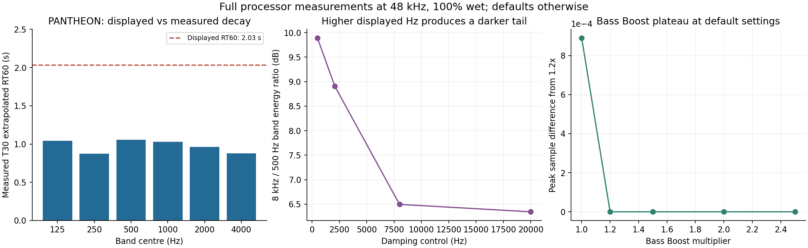

# T Studio — kiểm tra tác động âm thanh của 31 VST

31/10/2026. Báo cáo bổ sung cho bốn ZIP đã nhận, ưu tiên T-PANTHEON và cách dùng FX Send/AUX.

**Có vấn đề thật ở T-PANTHEON.** Sáu lựa chọn loại vang không đổi DSP; RT60 hiển thị lệch đáng kể so với phép đo ở cấu hình mặc định; một phần dải Bass Boost bị bão hòa; Damping có chiều đáp ứng không khớp một nút tần số cắt tính bằng Hz. Ngoài ra, nhiều preset là kiểu insert, đưa tiếng dry vào FX return.

Đợt kiểm tra trước tập trung vòng đời, NaN, cấp phát, license và bypass. Chưa phát hiện lỗi ở những bài thử đó không xác nhận mọi nút đã có tác động đúng hoặc chất tiếng đã đúng. **Các vấn đề DSP mới dưới đây chưa được sửa trong ZIP bản vá 5 file trước, và gói báo cáo bổ sung này không phải bản DSP đã sửa.**

## T-PANTHEON: đã đo được gì

| Điểm kiểm tra | Kết quả | Ý nghĩa |
|---|---|---|
| Hall / Chamber / Room / Plate / Ambience / Custom | Giữ nguyên các tham số khác, cả sáu đầu ra giống hệt từng mẫu ở 44,1 / 48 / 96 kHz. Sáu impulse response 48 kHz có cùng SHA-256. | Nguồn PhoenixChamber.h bỏ qua reverbType bằng ignoreUnused; chỉ có một mạng buồng vang. Giao diện thể hiện nhiều loại hơn DSP thực sự có. |
| RT60 mặc định 2,03 s | Ở 48 kHz, dải 1 kHz đo T30 ngoại suy RT60 khoảng **1,027 s**, R²≈0,9994. Các dải 125–4000 Hz khoảng 0,876–1,056 s. | Trong cấu hình này đuôi tắt nhanh hơn nhiều so với con số hiển thị. Không suy rộng thành mọi preset hay mọi cấu hình đều sai đúng một hệ số. |
| Bass Boost 1,2× → 1,5× → 2× → 2,5× | Đầu ra giống hệt từng mẫu ở cấu hình mặc định 48 kHz. Từ 1× lên 1,2× vẫn thay đổi. | totalBassGain chạm giới hạn 0,985 bên trong vòng hồi tiếp, nên vùng trên của nút mất tác động. Không được chỉ bỏ clamp: nó đang bảo vệ ổn định hồi tiếp. |
| Damping 500 / 2080 / 8000 / 20000 Hz | Tỷ lệ năng lượng dải 8 kHz / 500 Hz lần lượt khoảng 9,89 / 8,91 / 6,50 / 6,35 dB. Tăng số Hz làm đuôi tối hơn. | Công thức pole dùng sinh/cosh không ánh xạ đúng chiều của một tần số cắt thấp thông tính bằng Hz. Đây là phép so giữa các lần render cùng điều kiện, không phải điểm đánh giá nghe. |
| Pre-delay 0 → 50 → 150 ms | Thời điểm wet đầu tiên tại 48 kHz: khoảng 0,625 → 50,625 → 150,625 ms. | Nút này có tác động đúng phần trễ tăng thêm; không phải toàn bộ plugin chỉ là giao diện. |
| Delay | Không đổi âm thanh khi Regen=0; có đổi khi bật Regen=45%. | Nút phụ thuộc nhánh hồi tiếp. Không gọi đây là nút hỏng chỉ vì thử ở Regen=0. |
| Mix 0 / 100 và các nút mức | Có thay đổi đầu ra trong phép thử có license hợp lệ. | Có xử lý wet thực sự khi được cấp phép; không có bằng chứng cả plugin luôn passthrough. |

Cấu hình đo RT60: stereo impulse 0,1 đồng thời hai kênh; Mix 100%; Hall; Size 38 m; RT60 2,03 s; Spread 83%; Damping 2080 Hz; Bass Boost 1,2×; Bass Freq 381 Hz; Diffusion 65%; Regen 0; Delay 14 ms; Pre-delay 12 ms; echo -60 dB; input/output 0 dB. Trial QA hợp lệ. Không thêm EQ, normalize hoặc chỉnh sửa mức trong WAV lưu lại.

Phương pháp thời gian tắt: lọc Butterworth bậc 3 dải 1/3 octave quanh từng tần số, tích phân năng lượng ngược Schroeder, fit đường thẳng -5 tới -35 dB, RT60=-60/hệ số góc. T30 là đoạn giảm 30 dB dùng để ngoại suy thời gian giảm 60 dB. Không dùng độ dài file WAV làm RT60. Phép đo broadband T20 riêng trong JSON cho khoảng 0,891 s ở cấu hình mặc định; không trộn nó với kết quả dải 1 kHz.

## Điều rất dễ gặp trên FX Send/AUX

**34 trong 37 preset PANTHEON đặt Mix dưới 100%.** Ví dụ preset Vocal Hall đặt 22%, Vocal Plate 25%, Large Hall thứ hai 36%. Trên insert, cách trộn này có thể phù hợp. Trên FX Send, nó đưa thêm giọng gốc vào return và giảm lượng wet tương ứng. Ở Mix 22%, riêng hệ số wet đã thấp hơn Mix 100% khoảng 13,15 dB, chưa tính mức send/return.

Để thử đúng đường AUX hiện tại: chọn `Vocal Short - FX Send` hoặc `Vocal Body - FX Send`; hoặc sau khi chọn bất kỳ preset nào, đặt **Mix 100%**, rồi chỉnh lượng vang bằng Send/Return. Mỗi lần đổi preset khác cần xem lại Mix vì preset ghi đè nó. Hai preset FX Send có sẵn chỉ bảo đảm wet-only; chúng vẫn chạy mạng Chamber đang có, chưa sửa các vấn đề loại vang/RT60 nêu trên.

Điều này có thể giải thích cảm giác ít vang, vocal bị dày thêm hoặc không quyện khi đổi preset. Chưa có bản thu/route thực tế của lần này nên không khẳng định đây là nguyên nhân duy nhất trên máy anh.

## Những plugin thêm vào mà chưa nghe đổi tiếng

| Plugin | Kết quả đo và nguồn | Cách kiểm tra có tác động |
|---|---|---|
| T-RVox | Mặc định Comp=0 dB, Gate=-80 dB, Gain=0 dB. Ở tín hiệu thử, đầu ra trùng dry đã căn trễ. Đây là cấu hình trung tính. | Hạ Comp, ví dụ -12 tới -18 dB. Phép thử endpoint Comp và các nút trong điều kiện nén/gate hoạt động đều có khác biệt. |
| T-Vitamin | Drive của cả năm band mặc định bằng 0. Sai khác so với dry chỉ ở mức làm tròn float, khoảng -144 dB. | Tăng Harmonics/Drive của band. Đã đo các band có tác động; Punch/crossover có phản ứng khi bật Drive. |
| T-Pitch | Semitones/Cents=0: giữ nguyên cao độ; so với dry đã căn trễ khác khoảng -131 dB. Vẫn có độ trễ 120 ms ở Music mặc định. | Đổi Semitones để thử. Keep Formant có phản ứng trong Voice Live và khi đang dịch cao độ; Music cố ý không dùng giữ formant. |
| T-AutoKey | Là bộ phân tích/tạo dữ liệu key-scale, không phải hiệu ứng đổi tiếng trực tiếp. | Đánh giá kết quả nhận key/scale và handoff riêng, không chờ nghe màu tiếng đổi. Đợt này không chấm độ chính xác nhận key qua bài hát thật. |
| EQ | Band đang gain 0 không làm nút Frequency đổi màu đáng kể. HP/LP không dùng Gain; Slope phụ thuộc loại lọc. | Đã thử tăng gain/bật band và đo được tác động của các điều khiển liên quan. Các tổ hợp còn không đổi được ghi nguyên trong CSV, không tự gắn nhãn lỗi. |
| T-Compander | Detector mặc định là bandpass. Tín hiệu không vượt ngưỡng ở dải detector có thể không kích compressor. | Khi đặt ngưỡng -45 dB và detector 200 Hz cho tín hiệu thử, Ratio/Attack/Release đều thay đổi đầu ra. |
| T-HDelay | BPM/sync division chỉ ảnh hưởng các mode đồng bộ; Mod Rate cần Mod Depth. | Phép thử ở BPM mode và có modulation đo được tác động. |
| T-BE | Các voice bị tắt không phản ứng với level/pan/interval của voice đó; quãng cố định phụ thuộc Follow Scale. | Bật voice 3/4 và thử đúng Follow Scale/Fixed thì các nút có phản ứng. Auto Key cần dữ liệu handoff, không được kiểm chứng chỉ bằng âm thanh trong harness. |
| T-AutoTune | Key không phân biệt cùng cách khi đang Chromatic; Throat/Ratio Lock cần Formant và ngữ cảnh dịch cao độ; nhóm tạo vibrato cần Shape bật. | Khi bật các điều kiện liên quan, các nút đó đều đo được khác biệt. Advanced View chỉ đổi giao diện. |

Có **30 plugin xử lý âm thanh** trong bộ; mỗi plugin đều có ít nhất một điều khiển tạo khác biệt đầu ra trong phép đo. Plugin còn lại là T-AutoKey, chủ ý truyền audio nguyên dạng. Điều này xác nhận nguồn có đường xử lý hoạt động, không chứng minh mọi nút/tổ hợp đều đúng hoặc binary trên máy anh đang chạy cùng nguồn.

## Các điều khiển chưa có hiệu lực hoặc cần đọc đúng điều kiện

- **T-PANTHEON reverbType:** đã xác nhận bị DSP bỏ qua bằng cả nguồn và null test. Không phải sáu thuật toán độc lập.
- **LIQUID Delay HD/hdFilter:** đã xác nhận có tham số/giao diện nhưng processBlock không đọc nó, phép thử hai trạng thái không đổi audio. Bộ Filter thường vẫn hoạt động. Không vì vậy kết luận cả delay không chạy.
- **LIQUID Delay FX Mode/LFO:** thứ tự FX có tác động khi có Drive, các nút LFO hoạt động khi LFO bật và có depth. Manual Tempo không đổi trong lần thử đang chọn Host Sync; host giả lập cung cấp 90 BPM, nên không dùng kết quả này để kết luận Manual Tempo hỏng.
- **T-Verb bitdepth:** nguồn chủ ý dùng engine 64-bit cho cả hai giá trị lưu cũ 32/64. Nút/giá trị legacy không thể hiện hai chế độ precision thực tế. Cross Lo có tác động khi các tỷ lệ decay khác nhau; Echo Size cần Echo Intensity; Dry On cần mức Dry khác mute. Đã thử thêm các điều kiện này và thấy khác biệt.
- **T-LA-2A/T-Opto/T-VoxBox Meter:** đổi kiểu đo không cần làm đổi audio. Riêng OFF của Meter ở T-1176 được nguồn dùng làm bypass, vì vậy nó có đổi audio.
- **T-Comp Sidechain:** cần bus ngoài được bật và có routing trong DAW; harness lần này không cấp tín hiệu vào bus ngoài, nên chưa xác nhận nhánh đó bằng phép đo end-to-end. Auto Release/SC Frequency/Soft Clip đã có tác động trong cấu hình kích hoạt tương ứng.
- **T-Limiter:** các điều khiển động học/dither/style có khác biệt khi đẩy tín hiệu vào vùng limiting và bật dither. Thử ở mức dưới ngưỡng không đủ kết luận chúng bị bỏ qua.

`unchanged_in_tested_contexts` trong JSON/CSV là danh sách ứng viên của phép đo, không phải danh sách lỗi. Các phụ thuộc chưa được cấp tín hiệu hoặc tổ hợp chưa được thử không được tính là đã xác minh đúng/sai.

## License cũng có thể làm nghe như không có hiệu ứng

T-PANTHEON và nhiều plugin trong bộ chủ ý trả dry khi chưa được cấp phép/trial đã hết. Riêng T-PANTHEON lúc đó còn đưa meter wet về 0. Trên AUX, đường này có thể trả thêm giọng gốc mà không có vang. Cần xem badge `ĐÃ KÍCH HOẠT` hoặc `DÙNG THỬ ... NGÀY` của đúng binary trên máy anh. Không suy từ việc cửa sổ mở được rằng DSP đã được unlock.

**Các lỗi PANTHEON ở báo cáo này vẫn tái hiện khi license QA đang allowed**, nên không quy toàn bộ vấn đề cho license. Tất cả 31 lần chạy đợt này ghi nhận trạng thái QA allowed; dùng kho riêng, không sửa key/trial thật, không bỏ cơ chế cấp phép.

## Phạm vi và hướng sửa DSP

Đã chạy mã processor thật bằng Linux/JUCE 8.0.12, render tín hiệu xác định, so từng mẫu và thử phụ thuộc. 31 executable kết thúc bình thường. Đã kiểm tra 561 tham số, 137 phép thử bổ sung ở điều kiện phụ thuộc; 116 tham số cho thấy tác động trong điều kiện bổ sung sau khi gần như không đổi ở default. Những con số này không phải điểm nghe hay chứng nhận toàn bộ chức năng.

Phần baseline dùng bốn nguồn đã nhận, VocalPack 1.7.3 overlay trên nền 1.7.2 đầy đủ và năm file gia cố của đợt audit trước. T-PANTHEON/LIQUID Delay không bị sửa trong đợt vá trước; các phát hiện mới ở chúng áp dụng trực tiếp nguồn ZIP lần này. Adapter QA chỉ cấp SDK/runtime và store thử. Không sửa DSP sản phẩm trong lượt kiểm tra bổ sung này.

Các điểm cần sửa ở T-PANTHEON đã cụ thể:

1. Làm lựa chọn loại vang tác động tới xử lý thật và mô tả đúng số engine/voicing đang có. Giữ ID/thứ tự tham số để đọc project cũ; ghi rõ thay đổi âm thanh khi trước đây type bị bỏ qua.
2. Hiệu chuẩn chuyển RT60 sang hệ số hồi tiếp theo vòng trễ thực, rồi đo lại nhiều room size, loại vang, damping và sample rate. Không chỉ tăng một hệ số để khớp đúng một preset.
3. Sửa ánh xạ tần số của Damping/Bass shelf và kiểm tra đáp ứng tần số. Tách chỉnh màu bass khỏi giới hạn ổn định hồi tiếp; không gỡ bảo vệ chỉ để nút có tác động.
4. Cung cấp chế độ/preset FX Send bảo đảm wet-only sau khi đổi preset, đồng thời giữ preset insert cũ để không đổi project đã lưu.
5. Với HD của LIQUID, cần xử lý thực hoặc thể hiện rõ chưa hỗ trợ trên UI; không để nút báo bật như một chức năng DSP đang chạy.

Chưa chạy Cubase 15 Windows, binary VST3 trên máy anh, đường ASIO/monitor, bus sidechain ngoài, hay so nghe vocal thật lần này. Chưa xác định tất cả nguyên nhân DAW đơ; rủi ro worker license đợi I/O 30 giây từ báo cáo trước vẫn cần đối chiếu dump khi gặp treo.

Gói này gồm báo cáo, CSV, số đo JSON, mã harness, biểu đồ và một impulse response float32 không qua chỉnh sửa để kiểm tra độc lập. **Không có bộ cài, bản DSP đã sửa hay private key.**
