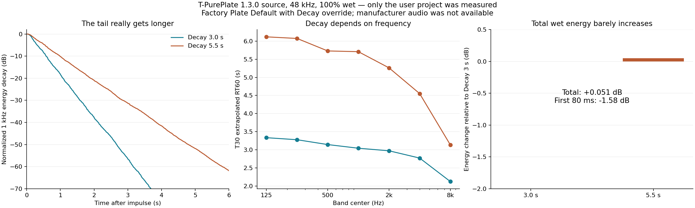

# Vintage 4 — rà lại mức tác động và độ vang

31/10/2026. Các nguồn T-PultecEQ, T-VoxBox, T-PurePlate và T-Lex224 trong ZIP Vintage 4 1.3.0 anh gửi. Chủ dự án xác nhận đã so 100% wet và cùng Send/Return. Đợt này tập trung phần mà kiểm tra “nút có tác động” trước đây chưa trả lời được: mức wet, phân bố đuôi và mức tác động thực của điều khiển.

**Chưa có audio bản hãng trong phép đo. Không kết luận đã tìm đủ nguyên nhân bản hãng nghe vang hơn và không coi bốn engine hiện tại là đã hiệu chuẩn tương đương hãng. Mã sản phẩm chưa được sửa trong đợt đo này.**

## T-PurePlate: đuôi dài hơn nhưng lượng wet gần như giữ nguyên

Đo qua processor thật với trial QA hợp lệ, stereo impulse 0,1 đồng thời hai kênh, 48 kHz, preset Plate Default, Wet Solo bật, Mix 100%, Input/Output 0 dB. Pre-delay 18 ms; Steel; Low Cut 90 Hz; Bass 0 dB; Treble +1,5 dB; Damper 35%; Dispersion 75%; Drive 2; Shine 25%. Làm ấm bằng silence 0,4 s rồi reset trước mỗi render.

| Số đo | Decay 3 s | Decay 5,5 s |
|---|---:|---:|
| RT60 ngoại suy T30 tại 1 kHz | 3.044 s | 5.708 s |
| RT60 ngoại suy T30 broadband | 2.830 s | 5.094 s |
| Tăng năng lượng wet tích phân so với mức 3 s | 0 dB | +0.051 dB |
| Đổi năng lượng 80 ms đầu so với mức 3 s | 0 dB | -1.579 dB |

Nguồn `common/VintageDSP.h` tự bù gain wet theo `0.9 * pow(2.2 / rt, 0.3)`. Riêng gain bù này giảm khoảng 1,58 dB khi đi từ 3 lên 5,5 s. Nó có thể giữ lượng vang tổng gần ổn định và làm phần vang đầu nhẹ đi, dù đuôi kéo dài. Đây là bù mức tĩnh theo nút Decay, không phải compressor đang nén theo vocal.

Kết quả không cho thấy lỗi kiểu “đặt 3 s nhưng đuôi chỉ còn một nửa” ở cấu hình này. Nó cũng không chứng minh màu tiếng đã đúng hãng. Mật độ phản xạ, envelope phần đầu và suy hao từng dải của hai thiết kế có thể khác; cần audio tham chiếu để xác định độ chênh cụ thể.

Mix 100% và Wet Solo của nguồn này đã được so: sai khác mẫu lớn nhất 4.37e-09, tương ứng lượng làm tròn float nhỏ. Không lấy Mix làm nguyên nhân cho lần so mà anh đã xác nhận wet-only. Range Reverb Time của nguồn là 0,5–5,5 s; yêu cầu 6 s bị chặn tại 5,5 s, đầu ra trong phần thời lượng chung giống từng mẫu.

## Hai reverb và các điều khiển không được hiệu chuẩn theo cùng mô hình hãng

T-Lex224 có bù wet theo thời gian tương tự: từ Mid/Bass cùng 3 lên cùng 6 s ở Program 0, năng lượng impulse wet thay đổi khoảng −0,025 dB trong điều kiện thử, dù đuôi kéo dài. Đây là mạng FDN tám đường trong dự án; tài liệu hãng mô tả phần mềm dùng các thuật toán của 224 gốc. Không có cơ sở coi cùng tên/vị trí nút là cùng đáp ứng.

Một khác biệt chức năng cụ thể: `immed` trong nguồn T-Lex224 cho late field bỏ qua Pre-delay. Tài liệu hãng mô tả Immediate là cách giữ các giá trị khi đổi program. Nguồn cũng đặt range Bass/Mid, Diffusion và Mode Enhancement khác tài liệu hãng. Các khác biệt này cần được xử lý riêng nếu mục tiêu là cùng cách vận hành; chưa tự đổi chúng trong lượt đo này.

Theo tài liệu Pure Plate của hãng, Reverb Time điều chỉnh damping của plate; Wet Solo tương đương Mix 100% và mặc định On. Dự án hiện dùng tank plate với suy hao feedback theo RT cùng Damper thêm riêng và EQ shelf RBJ. Vì thế đo được RT gần số hiển thị vẫn chưa kiểm chứng độ quyện/màu/tác động ngang với bản hãng.

## PultecEQ và VoxBox có tác động rõ trong phép đo đơn vị

- T-PultecEQ, Clean, các boost/cut khác bằng 0, HF 10 kHz: HF Boost 3/6/10 cho +4,8/+9,6/+16,0 dB tại 10 kHz. LF Boost 3 tại nấc 60 Hz cho khoảng +3,90 dB ở 60 Hz. Điều này xác nhận gain EQ có tác động; không chứng nhận đúng đường cong Pultec hãng ở mọi vị trí.
- Màu amplifier phụ thuộc mức vào và Drive. Ví dụ TUBE, Drive 2,5, sine 1 kHz peak −18 dBFS: THD H2–H8 khoảng −51,3 dB; Drive 10 khoảng −27,5 dB. Cần so ở cùng mức vào, không chỉ cùng vị trí nút. IRON và CLEAN là các nhánh có hành vi khác.
- T-VoxBox, 3:1/Threshold −18 dB, các stage khác tắt trong phép thử: sine 1 kHz peak −6 dBFS bị nén khoảng 8,02 dB so với Comp Off. Attack/Release/EQ/màu preamp cần tín hiệu tham chiếu riêng để đánh giá độ giống hãng. Chưa có bằng chứng các stage này hoàn toàn không hoạt động.

## Phương pháp và giới hạn

4 executable processor hoàn tất, 56 render impulse và 54 ca tone. Các nguồn DSP/wrapper được đối chiếu SHA-256 và khớp bản nguồn Vintage 4 đang kiểm tra. Các render reverb ở 44,1/48/96 kHz; trial QA allowed, store riêng. QA dùng runtime JUCE 8.0.12/Linux, không chạy VST3 Windows hay Cubase 15/ASIO.

Đo từng dải bằng Butterworth bậc 3 dải 1/3 octave, tích phân Schroeder và fit −5..−35 dB; lưu cả T20, R² và EDT. Năng lượng wet là tổng bình phương stereo, lấy trung bình hai kênh rồi so với năng lượng impulse đầu vào. Đây là năng lượng tuyến tính của đáp ứng xung, không phải LUFS hay điểm nghe và không có nghĩa loudness vocal luôn giữ nguyên 0,05 dB. Dữ liệu density trong JSON chỉ là proxy Gaussian exceedance cửa sổ 20 ms, chưa được đối chiếu với bản hãng.

Chưa có bản thu so của hai plugin, nên chưa phân định được bao nhiêu chênh lệch do mức wet, envelope, mật độ, màu lọc, cách map knob hoặc binary đang cài khác nguồn. Không đổi thang Decay để giả cảm giác “3 giây thành 6 giây” và không tự tăng gain cả bốn khi chưa có chuẩn đối chiếu.

## Dữ liệu cần cho lượt hiệu chuẩn tiếp

Hai bản xuất cùng một đoạn vocal qua PurePlate hãng và T-PurePlate, cả hai 100% wet/Decay 3 s, cùng đầu vào và Send/Return; tắt normalize, giữ khoảng 10 giây đuôi sau câu hát. Ghi lại Pre-delay, Bass/Treble, Low Cut và phiên bản plugin. Cặp này cho phép so lượng wet và hình dáng đuôi ở cùng điều kiện trước khi chỉnh DSP; các plugin khác cần cặp so tương ứng.

Tài liệu hãng đã đối chiếu:

- [Pure Plate Reverb Manual](https://help.uaudio.com/hc/en-us/articles/4419497304340-Pure-Plate-Reverb-Manual)
- [Lexicon 224 Digital Reverb Manual](https://help.uaudio.com/hc/en-us/articles/4419497193492-Lexicon-224-Digital-Reverb-Manual)

[Dữ liệu số và SHA-256 nguồn](TSTUDIO_VINTAGE4_WET_RESPONSE_METRICS_20261031.json).
