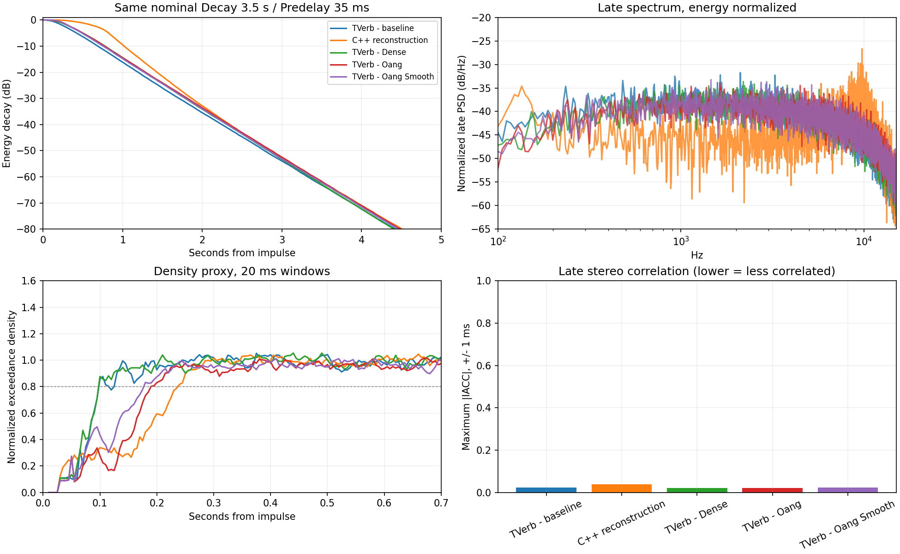

# TVerb: so sánh hai lõi và thử hướng vang dày, oang

Mục tiêu của anh: giữ cảm giác bay, phát triển theo hướng **vang dày và oang hơn**. Kết quả hiện tại ủng hộ việc thử preset và chỉnh cách đuôi vang nở trước khi thay lõi DSP. TVerb có sẵn các thành phần cần thiết; file C++ dựng lại dùng chung nhiều bảng nhưng cho đầu ra khác rõ.

**Đây là so sánh TVerb với file C++ anh gửi, chưa phải A/B với plugin ArtsAcoustic chạy thật.** Tên, địa chỉ và tuyên bố “100%” trong file không xác nhận nguồn gốc hay tính tương đương. Không có phần thu từ DLL hãng trong các WAV kèm theo.

[Tải ZIP nghe A/B và thông số](TVerb_Day_Oang_AB_20261108.zip?raw=true) — 13.5 MB.

## Nghe thử

Giải nén toàn bộ ZIP rồi mở **`listen/index.html`** bằng Chrome/Edge. Bấm chọn mẫu để chuyển ở cùng vị trí phát. Có thể mở các WAV trực tiếp trong DAW. Nên so `TVerb nền` với `Dày` và `Oang mềm` trước.

- Cùng một chuỗi **nguyên âm tổng hợp**, có rung nhẹ; không phải bản thu vocal thật của anh.
- Mức RMS của đường vang đã được cân bằng giữa các mẫu, cùng một đường dry. Không cân bằng LUFS và không khẳng định độ lớn cảm nhận hoàn toàn bằng nhau.
- `Có giọng gốc` = dry + wet; `Chỉ tiếng vang` = wet. Cả hai đều chứa toàn bộ phần đuôi sau câu.
- Các tên `Dày`, `Oang`, `Oang mềm` biểu thị **mục tiêu thử nghiệm**, chưa phải kết luận nghe hay hơn trên giọng thật.

## Hai lõi giống và khác ở đâu?

Cả hai đều thuộc họ vang thuật toán: phản xạ sớm, comb hồi tiếp, allpass khuếch tán và delay điều biến stereo. Những bảng Room Type/ER đã đối chiếu có cùng dữ liệu. Tuy nhiên, sơ đồ comb, cách diễn giải trường trong bảng, hiện thực allpass, điều khiển modulation, gain và đường Quality không đồng nhất. Cùng bảng không có nghĩa là cùng đáp ứng âm thanh.

Đã render trực tiếp hai source, cùng input stereo 48 kHz, block 256, Decay danh nghĩa 3,5 s, Predelay 35 ms, wet-only, gain output 0 dB. Các điều khiển chung được ghép gần tương ứng; hai API **không có ánh xạ đầy đủ 1:1**.

| Số đo | TVerb nền | C++ dựng lại |
|---|---:|---:|
| T60 broadband ngoại suy từ đoạn -5..-25 dB | 3,046 s | 2,471 s |
| T60 dải 500 Hz, cùng cách fit | 3,510 s | 3,374 s |
| T60 dải 4 kHz | 2,776 s | 2,589 s |
| Năng lượng trong 80 ms đầu sau khi vang bắt đầu / tổng | 8,89% | 0,35% |
| Proxy mật độ, trung bình 80–300 ms sau onset | 0,963 | 0,673 |
| Tương quan stereo muộn tối đa trong ±1 ms | 0,024 | 0,038 |
| RMS vang trên chuỗi nguyên âm, trước cân bằng | mốc 0 dB | cao hơn 9,87 dB |

Các số này áp dụng cho cấu hình thử, không đại diện mọi preset. T60 broadband thấp hơn nút 3,5 s một phần vì Hi Ratio đặt 0,60; không dùng riêng số broadband để kết luận nút Decay sai. T60 là ngoại suy từ độ dốc EDC, không phải thời gian “hết nghe thấy vang”.

Mức 9,87 dB là khác biệt gain/đáp ứng của toàn hệ trên đúng tín hiệu thử. Nếu nghe hai mẫu chưa cân bằng, phần lớn cảm giác “vang nhiều hơn” có thể đến từ mức tiếng. Sau cân bằng, cách nở và phân bố phổ vẫn khác. Các phép đo hiện tại không chứng minh bản dựng lại hay hơn hoặc giống hãng hơn.

## Ba hướng thử trên chính TVerb

Giữ Decay 3,5 s và Predelay 35 ms để quan sát sự thay đổi kết cấu thay vì chủ yếu kéo dài đuôi. Không sửa source DSP sản phẩm.

| Thông số | Nền so sánh | Dày | Oang | Oang mềm |
|---|---:|---:|---:|---:|
| Room Type | smooth | smooth | large | large |
| Size | 40 m | 42 m | 50 m | 50 m |
| Width | 160° | 170° | 175° | 175° |
| Attack / Spread | 7 / 10% | 3 / 24% | 6 / 28% | 4 / 22% |
| Diffusion / Density | 70 / 80% | 82 / 95% | 72 / 92% | 84 / 97% |
| Lo / Mid / Hi Ratio | 1 / 1 / 0,60 | 0,90 / 1 / 0,72 | 0,95 / 1 / 0,78 | 0,95 / 1 / 0,76 |
| Low Cut / High Cut | 120 / 9819 Hz | 120 / 10500 Hz | 120 / 11500 Hz | 120 / 11000 Hz |
| Crossover Lo / Hi | 800 / 4000 Hz | 750 / 4000 Hz | 750 / 4000 Hz | 750 / 4000 Hz |
| Modulation | 10% | 14% | 18% | 16% |

Chung: Dry **tắt**, Wet bật, Wet Level 0 dB trước cân bằng, Quality Normal, Echo Intensity 0%, Echo Size hiển thị 400 ms. Echo Intensity 0 không bypass toàn bộ tầng modulation/echo trong engine hiện tại.

Giá trị đầy đủ ở [`presets/TVerb_manual_settings.json`](tverb-comparison-20261108/presets/TVerb_manual_settings.json): **để nhập tay/tham khảo, chưa phải định dạng preset mà plugin có thể import**. Mức Return khi dùng thật tùy bản phối; không chép gain cân bằng của WAV thành một chuẩn loudness cho mọi vocal.

| Kết quả thử | Nền | Dày | Oang | Oang mềm |
|---|---:|---:|---:|---:|
| T60 broadband | 3,046 s | 3,064 s | 3,112 s | 3,105 s |
| T60 dải 4 kHz | 2,776 s | 2,977 s | 3,056 s | 3,042 s |
| Năng lượng 80 ms đầu / tổng | 8,89% | 3,13% | 2,40% | 1,20% |
| Proxy mật độ 80–300 ms | 0,963 | 0,961 | 0,768 | 0,841 |

`Dày` giữ độ đặc xuất hiện sớm của smooth và giữ dải cao lâu hơn. `Oang mềm` chuyển sang không gian large, thiên về đuôi muộn hơn; proxy mật độ tăng so với `Oang` nhưng chưa bằng smooth ở đoạn đầu. Vì vậy không diễn giải tên preset thành “mọi thời điểm đều nhiều phản xạ hơn”.

**Đề xuất thử `Oang mềm` làm hướng phát triển**, đối chiếu với `Dày` khi cần tiếng bám câu hơn. Các mẫu này chưa được chấm nghe trên vocal thật của anh.

## Những nâng cấp DSP đáng ưu tiên

1. **Điều khiển tỷ lệ early/late và độ nở của đuôi độc lập.** Hiện Diffusion đồng thời ảnh hưởng gain phản xạ sớm, còn Density thay đổi số tầng trong mạng. Tách các vai trò sẽ giúp chỉnh “quyện” và “oang” chính xác hơn. Cần cân bằng mức qua các cấu hình khi phát triển để tránh chỉ tăng gain.
2. **Duy trì đuôi dày nhưng không lộ nhịp lặp.** Thử riêng hình học large, độ khuếch tán, thời điểm phản xạ dồn lên và modulation nhẹ. Bài đo cho thấy smooth đã đạt proxy mật độ cao; tăng Density lên tối đa không tự bảo đảm vang mềm hơn.
3. **Giữ màu đuôi ở trung/cao vừa phải.** Hi Ratio 0,72–0,78 trong các mẫu giúp dải cao tắt chậm hơn so với 0,60. Giữ low-cut khoảng 120 Hz và Low Ratio dưới 1 làm điểm xuất phát cho preset oang trên AUX; cần nghe với vocal/nhạc thật để chốt độ sáng và độ ù.
4. **Giữ đường Quality/resampler đã có, thêm chuyển tham số êm.** TVerb có đường xử lý sample rate nội bộ thực; file C++ mới chưa triển khai chọn Quality tương ứng. Đổi Room Type/Quality hiện reset tail, gain Dry/Wet chưa có smoothing đầy đủ. Đây là phần nên hoàn thiện khi muốn thao tác live.

Ngoài chất tiếng, lượt rà trước đã tái hiện trạng thái TVerb bị nhiễm NaN/Inf nếu input có một frame lỗi. Cần xử lý đầu vào/trạng thái không hữu hạn khi làm bản sửa sản phẩm. Các tín hiệu hữu hạn trong **15 render lần này đều có 0 mẫu không hữu hạn**; điều đó không thay thế bài thử lỗi đầu vào trước.

## Dữ liệu và giới hạn

- Render: 5 cấu hình × 3 input = 15 lượt, mỗi lượt 14 s, stereo 48 kHz. Input gồm impulse 0,25, nguyên âm tổng hợp và chuỗi âm gảy/noise tắt dần. Các WAV nghe thử dùng nguyên âm; số đo đáp ứng dùng impulse.
- C++17, GCC tối ưu O2, tắt FP contraction; TVerb đi qua wrapper ép lõi double, C++ mới dùng float. Đây là hành vi hai source đang cung cấp, không ép chúng thành cùng thiết kế.
- EDC Schroeder trên tổng năng lượng L/R; fit T20 từ -5 đến -25 dB và kiểm tra thêm độ dốc -15 đến -35 dB. Các fit chính có R² trên 0,999 ở cấu hình thử. Dải octave dùng bandpass Butterworth bậc 3.
- “80 ms đầu” tính từ onset riêng của từng đáp ứng, ngưỡng onset -80 dB so với peak IR. Đây là tỷ lệ năng lượng do bài so sánh định nghĩa, không phải đo C80 theo chuẩn phòng âm từ thời điểm impulse.
- Proxy mật độ: cửa sổ 20 ms, hop 5 ms, tỷ lệ mẫu lệch trung bình quá một độ lệch chuẩn, chuẩn hóa theo Gaussian. Chỉ báo thống kê, không phải điểm nghe hay; tín hiệu có tính chu kỳ cũng có thể đẩy chỉ số lên.
- Stereo: lấy từ onset +80 ms tới onset +2 s. Tương quan thấp không tự bảo đảm ít méo, âm hình đẹp hoặc mono hoàn hảo; không dùng riêng chỉ số này để chốt Width.
- Phổ muộn ở hình được chuẩn hóa tổng năng lượng trước khi so. Đỉnh/đáy khác nhau không tự chứng minh lỗi tái dựng; còn phụ thuộc topology và mapping.
- Cân bằng WAV: cùng RMS wet trên toàn clip 14 s, cùng dry, cùng master gain 1,0. Không chỉnh EQ/limiter/loudness riêng cho từng engine. WAV PCM16 phục vụ nghe; phân tích dùng float trước khi xuất WAV.
- Không chạy DLL Windows, không render plugin hãng, không kiểm tra Cubase/CPU toàn plugin. File vocal cũ chưa tải lại được nên chưa đối chiếu giọng thật. Những kết luận về cảm giác “bay/mềm” cần xác nhận bằng A/B vocal thật.
- Chưa tạo VST3 hay bộ cài mới. Gói này là **báo cáo + mẫu nghe + thông số thử**. Không kèm DLL hoặc source hãng.
- Kiểm tra file giao: 11 WAV stereo PCM16 đúng 48 kHz/14 s, không có mẫu chạm trần số. Trang nghe đã qua kiểm tra nút chuyển mẫu giữ vị trí, wet-only, tiếp tục phát và màn hình 390 px trong Chromium qua HTTP hỗ trợ byte range. Chính sách trình duyệt đám mây chặn `file://`, nên chưa xác nhận trực tiếp cách mở file cục bộ trong môi trường này; WAV vẫn mở độc lập được bằng trình phát/DAW.

Chi tiết: [`report/metrics.json`](tverb-comparison-20261108/report/metrics.json), [`report/render-results.json`](tverb-comparison-20261108/report/render-results.json), [`report/source-hashes.json`](tverb-comparison-20261108/report/source-hashes.json), [`listen/audition.json`](tverb-comparison-20261108/listen/audition.json). Mapping đầy đủ của C++ dựng lại ở [`report/cpp-parameter-mapping.json`](tverb-comparison-20261108/report/cpp-parameter-mapping.json).
