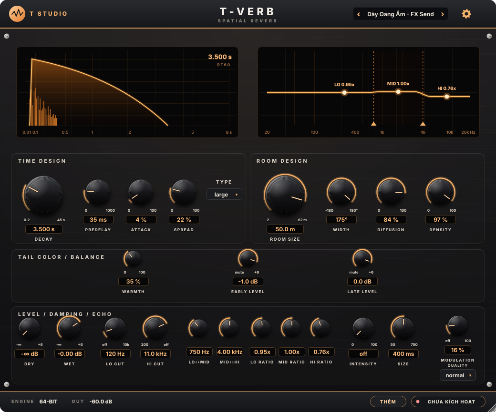

# T-Verb 1.3.0 — Dày, oang và ấm nhẹ

Bản nâng cấp từ `TVerb.zip` anh cung cấp: thêm **Warmth**, **Early Level**, **Late Level**, ba preset mới và xử lý chuyển Room Type/Quality ở nền. Lõi vang và các bảng có sẵn được giữ làm nền phát triển.

**Đây là gói mã nguồn đầy đủ để build Windows/macOS, chưa phải bộ cài hoặc VST3 Windows/macOS đã biên dịch.** Đã build được VST3 Linux và kiểm tra phần state/giao diện tại môi trường hiện có; chưa chạy Cubase 15 Windows.

[Tải ZIP mã nguồn đầy đủ — 17.1 MB](TVerb_1_3_0_WARM_SOURCE_WIN_MAC.zip?raw=true) · [Báo cáo kiểm tra](tverb-warm-upgrade-20261108/Validation/REPORT.md)

## Dùng bản mới

1. Windows: giải nén vào đường dẫn ngắn, ví dụ `C:\TVerbWarm`. Cài **Visual Studio 2022 — Desktop development with C++**, Windows SDK và **CMake 3.22+**. Chạy `build_windows.bat`.
2. Nếu build và test thành công, plugin nằm ở **`dist/VST3/T-Verb.vst3`**. Chép cả thư mục `.vst3` vào thư mục VST3 mà Cubase quét; Windows thường dùng `C:\Program Files\Common Files\VST3`.
3. macOS: có Xcode command line tools và CMake, chạy `bash build_mac.command`. Kết quả ở `dist/VST3` và `dist/Components`. Mặc định cấu hình universal Intel/Apple Silicon; chưa biên dịch/xác minh trên máy Mac trong lần giao này.

SDK JUCE 8.0.12, font và các phần shared cần thiết đã kèm trong gói; không cần tải JUCE khi build. Script chỉ xuất plugin vào `dist`, không tự ghi đè plugin đang cài trong máy.

Trên **FX Send/AUX**, chọn preset **“Dày Oang Ấm - FX Send”** trước. Preset này tắt Dry, bật Wet, dùng Large, Decay 3,5 s, Predelay 35 ms và Warmth 35%. Điều chỉnh lượng vang bằng Send/Return theo bản phối.

Hai preset còn lại: **“Vocal Dày Ấm - FX Send”** và **“Dày Oang Ấm - Insert”**. Các preset cũ vẫn ở nguyên thứ tự và có Warmth/Early/Late trung tính. Mở plugin ở preset cũ sẽ không tự bật màu ấm.

## Ba nút mới

| Nút | Tác dụng | Mức ban đầu nên thử |
|---|---|---:|
| Warmth | Tô màu riêng phần đuôi muộn; tăng thân tiếng nhẹ quanh 320 Hz và hạ nhẹ dải cao | 25–35% |
| Early Level | Mức phản xạ sớm, giúp điều chỉnh độ bám giọng | 0 đến −2 dB |
| Late Level | Mức đuôi muộn, điều chỉnh độ nổi của không gian vang | 0 dB |

Warmth 100% dùng một bell rộng +1 dB tại 320 Hz và high shelf −2 dB tại 5,5 kHz; các mức nhỏ hơn trộn dần với đuôi chưa tô màu. Ở 35%, hiệu ứng khá nhẹ. Warmth không có saturation/limiter, không thêm bộ đệm lookahead và không tác động lên đường Dry hoặc phản xạ sớm.

Warmth, Early/Late và gain Dry/Wet có ramp 30 ms khi thay đổi trong lúc chạy. Mức Early/Late là −60 đến +6 dB; −60 dB được dùng làm mute. Đây là gain riêng của hai nhánh, không thay thế Lo/Mid/Hi Ratio đang điều khiển thời gian suy hao từng dải.

## Đổi chế độ và độ ổn định

- Khi đổi Room Type/Quality lúc đang chạy, một worker chuẩn bị mạng dự phòng và xóa bộ đệm ở nền. Audio tiếp tục qua mạng đang hoạt động rồi chuyển chéo 150 ms khi mạng mới sẵn sàng. Bình thường chỉ một mạng render; trong đoạn chuyển có hai mạng render.
- Đuôi cũ được fade ra trong 150 ms, không giữ nguyên toàn bộ đuôi cũ đến hết. Việc đổi chế độ có thể bắt đầu sau một khoảng chờ ngắn của worker; luồng vocal vẫn chạy trong khoảng đó.
- Trong chế độ render offline do host báo, plugin chờ cấu hình sẵn sàng ở ranh giới block, giúp cùng lịch automation/block cho kết quả lặp lại, không phụ thuộc worker chạy kịp vào thời điểm nào.
- Thay NaN/Inf ở đầu vào bằng 0 trước cả phần DSP, bypass và meter. Nếu đầu ra nội bộ không hữu hạn vẫn xuất hiện, engine chặn đầu ra lỗi và reset trạng thái để hồi phục.
- Mẫu spectrum và sample rate dùng cho UI được truyền bằng atomic, tránh việc audio/UI đọc ghi đồng thời trên biến thường.

Hai mạng cần thêm bộ nhớ. Các phép đo tại môi trường Linux hiện có được ghi ở `Validation`; không xem đây là chứng nhận deadline live trên Windows/soundcard của anh. Smoothing mới áp dụng cho các gain và Warmth; không khẳng định mọi automation của các tham số hình học cũ đều hoàn toàn không tạo tiếng chuyển.

## Giữ bài cũ và dọn ghi chú

Giữ các ID tham số cũ, vị trí host Bypass cũ và thứ tự preset cũ. Ba tham số mới được thêm sau Bypass. Khi đọc state cũ thiếu ba nút mới, plugin đưa chúng về Warmth 0%, Early/Late 0 dB, kể cả khi trước đó đang chọn một preset ấm.

Đã dọn 142 comment nói về binary/địa chỉ/tái dựng trong phần source TVerb. Bước dọn comment không đổi mã DSP sau tiền xử lý. Sau nâng cấp, đầu ra ở trạng thái trung tính còn được đối chiếu với source gốc trong 9 cấu hình sample rate/Quality: các float bằng nhau trong điều kiện thử tĩnh đã ghi ở `Validation/legacy-neutral-comparison.json`. Điều này không có nghĩa bản mới ở mọi trạng thái động đều cho tiếng giống bản cũ, vì ramp và chuyển chế độ đã được nâng cấp.

## Kiểm tra và mẫu nghe

Các kiểm tra và giới hạn được ghi trong **`Validation/REPORT.md`**. Thư mục **`Examples`** có ba WAV dùng nguyên âm tổng hợp; mẫu 02 và 03 chỉ khác Warmth 0%/35% trước cân mức RMS đường vang. Đây không phải vocal thật của anh hoặc tiếng xuất từ plugin hãng.

## Thành phần của gói

- `src`: source TVerb nâng cấp; `tests`: các bài kiểm tra DSP/state/UI.
- `CMakeLists.txt`, hai script build và `third_party/JUCE`: project độc lập.
- `common`, `shared/licensing`, `Resources/Fonts`, cấu hình brand/public key: bổ sung từ gói T-Studio FX 1.2.3 đã có để giải quyết các dependency thiếu trong TVerb.zip. Panel được vẽ bằng mã với bố cục hai màn hình và các cụm nút, vì ZIP đầu vào không kèm SkinData/HwKit mới.
- Logic bản quyền dùng chung được giữ; không kèm private key hoặc công cụ phát key. Nếu project đang dùng brand/public key riêng, giữ cấu hình tương ứng của project đó khi tích hợp.
- Thông báo giấy phép của JUCE, font và phần shared được giữ trong gói.

Để ghép vào một bundle có sẵn, dùng thư mục `src` và cập nhật danh sách nguồn/include/CMake phù hợp; hàm worker nằm trong `TVerbReverbDSP.cpp`, engine cần C++17 và `Threads::Threads`. Gói độc lập này có sẵn cấu hình đó.
