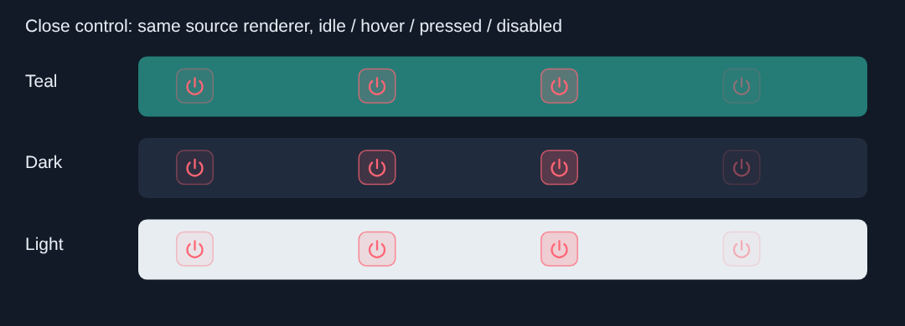

# Bản vá LiveNT

## Bản mới: khôi phục EQ Míc và làm gọn nút đóng

**[Tải bản vá V2](https://github.com/tinhbovo280899-boop/tinh-studio-storep/raw/refs/heads/livent-patches/patches/LiveNT_KHOI_PHUC_EQ_MIC_NUT_DONG_V2.zip)**

- Chuột phải Míc có lại Trầm / Ấm / Rõ lời / Sáng, Cắt ù, Nâng cao và Về preset;
  giữ Giảm ồn. EQ vẫn dùng Manny Marroquin EQ theo mục Gán nút hiện có.
- Nút đóng giữ biểu tượng đỏ, nền dịu và viền mảnh; thống nhất kiểu vẽ đầy đủ/
  thu gọn, căn chiều cao với các nút cùng hàng.
- Dựa trên Source.zip mới nhất người dùng gửi; giữ các thuật toán audio/scanner
  trong bản đó. Chỉ thay 5 file source.

Giải nén vào thư mục gốc dự án đầy đủ, chép đè 5 file trong Source rồi build lại.
Gói có hướng dẫn, diff, hash và ảnh minh họa kiểu nút.
Đây là bản vá mã nguồn, chưa có EXE hoặc bộ cài đã build.

43 kiểm tra độc lập về callback EQ/Giảm ồn đã đạt với đối tượng VST/UI mô phỏng.
Chưa build/chạy JUCE trên Windows hoặc Waves/ASIO thật. Các lỗi thuật toán
được đánh giá riêng ở bản mới chưa được sửa trong gói chỉnh giao diện này.

Ảnh dưới là minh họa thân hàm vẽ nút trên ba nền, không phải ảnh chạy toàn bộ DAW:

## Bản trước: 4 yêu cầu ban đầu

[Tải bản cũ](https://github.com/tinhbovo280899-boop/tinh-studio-storep/raw/refs/heads/livent-patches/patches/LiveNT_PATCH_4_YEU_CAU.zip)

Bản cũ bỏ quá rộng popup Míc; dùng V2 bên trên để lấy lại các dải EQ.
